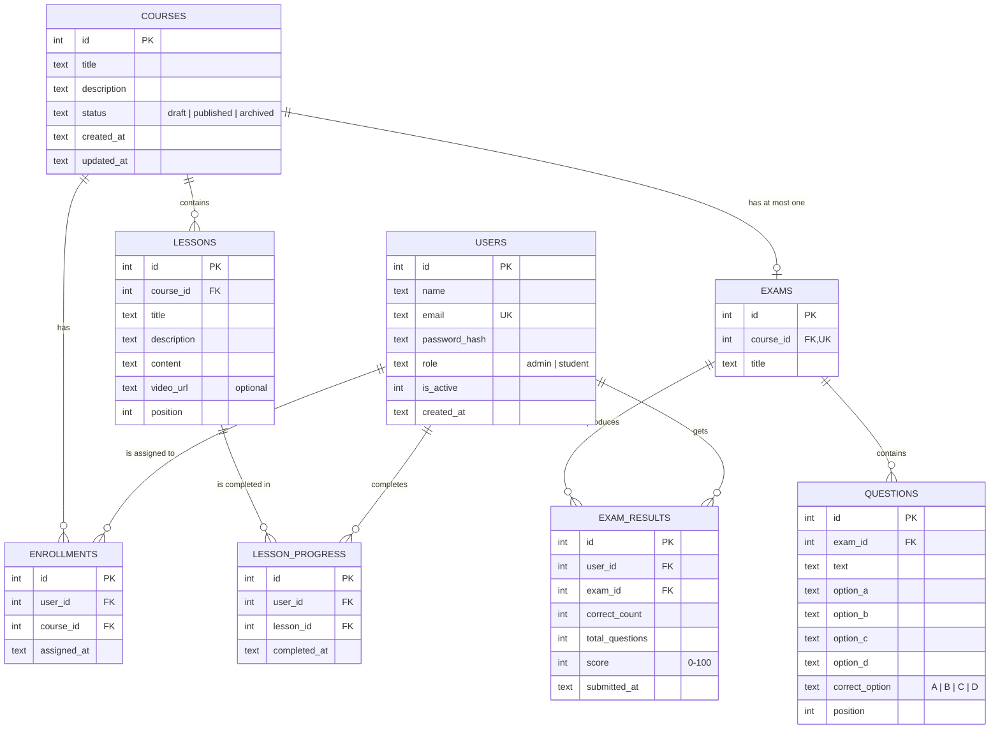

# Database design (Task 3)

The LMS uses **SQLite**, a SQL database stored in a single file (`server/data/lms.db`).
The tables are defined in [`server/src/db/schema.sql`](../server/src/db/schema.sql) and are created
automatically when the app starts or when you run `npm run db:init`.

## Entity relationship diagram

## Tables

| Table | Plan name (Turkish) | What it stores |
| --- | --- | --- |
| `users` | Kullanıcı | Admins and students. Passwords are stored only as bcrypt hashes. |
| `courses` | Kurs | Courses with a status: draft, published or archived. |
| `lessons` | Ders | Lessons of a course, shown in `position` order. Video link is optional. |
| `enrollments` | Kurs kaydı | Which student is assigned to which course. |
| `lesson_progress` | Ders ilerlemesi | One row for each lesson a student has completed, with the date. |
| `exams` | Sınav | One exam per course. |
| `questions` | Soru | Four options and one correct answer per question. |
| `exam_results` | Sınav sonucu | A student's score for an exam. |

## How the business rules are enforced by the database

| Rule | How |
| --- | --- |
| BR-02 Passwords are hashed | `password_hash` column; hashing happens in `userModel.js` with bcrypt (12 rounds). |
| BR-03 Email is unique | `UNIQUE` on `users.email`, case-insensitive (`COLLATE NOCASE`). |
| BR-04 Course status | `CHECK (status IN ('draft', 'published', 'archived'))` |
| BR-07 No duplicate assignment | `UNIQUE (user_id, course_id)` on `enrollments` |
| BR-09 No duplicate completion | `UNIQUE (user_id, lesson_id)` on `lesson_progress` |
| BR-13 One exam per course | `UNIQUE` on `exams.course_id` |
| BR-14 Four options, one correct | Four option columns and `CHECK (correct_option IN ('A','B','C','D'))` |
| BR-17 One exam attempt | `UNIQUE (user_id, exam_id)` on `exam_results` |
| Deleting data | `ON DELETE CASCADE`: deleting a course also deletes its lessons, enrollments, exam and results. Courses are normally archived, not deleted (BR-05). |

## Calculated values (not stored)

- **Course progress %** = completed lessons ÷ total lessons × 100, calculated with a query
  from `lessons` and `lesson_progress` (BR-10, BR-11).
- **Exam score** is calculated on the backend when the student submits and then saved in
  `exam_results.score` (BR-16).
